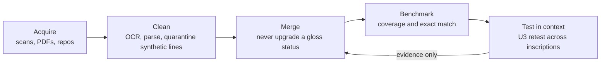

# Meroitic Decipherment

**Verdict:** The system explains known texts but cannot translate unseen inscriptions. Decipherment is incomplete.

## 1. What this is

Meroitic was the language of the Kingdom of Kush, in present-day Sudan. People wrote it from 300 BCE to 450 CE. Scholars can read the script, but the language is still partly undeciphered. This repo holds the data, tools, and benchmark results of a computational decipherment project. It shows what works, what does not, and where help is needed.

## 2. Status

**Achieved**

- We built a corpus of 460 real texts and 5,791 tokens.
- The corpus contains 0 synthetic lines.
- We quarantined 17,257 augmented lines from Otten 2025 and never used them.
- We merged two lexicons into 1,432 records under a strict rule.
- The rule says a merge never upgrades a gloss status.
- We OCRed the Rilly 2003 Vol. II lexicon into 744 entries.
- Anyone can recompute the benchmark with one script.
- We retested newly covered tokens in context with the U3 method.
- We ingested REM 0413, a text the lexicon never cites.

**Not achieved**

- The system cannot translate unseen inscriptions.
- No proposed gloss has been upgraded to certain.
- The merge did not raise certain coverage or exact-match accuracy.
- No true blind test has been run yet.
- REM 0413 is not yet merged into the corpus.
- We do not hold the full Hallof Vol. 7.
- The 88 unpublished Qasr Ibrim Vol. III texts are not in our corpus.

## 3. The numbers

The benchmark uses 4 royal narratives. The merge did not change these scores.

| Narrative | Certain coverage | Exact match |
|---|---|---|
| REM 1044 | 20.8% | 17.0% |
| REM 1003 | 28.9% | 21.4% |
| REM 0094, FHN witness | 21.3% | 11.3% |
| REM 0094, Millet witness | 12.4% | 7.6% |

**Read these numbers with care.** The benchmark measures lexicon coverage, not prediction. The lexicon already cites nearly every held-out token as an attestation. For example, REM 1044 has 138 certain tokens, and 137 of them cite it.

**Effect of the merge**

- Gap tokens fell from 1,535 to 1,357, down 178.
- Gap types fell from 715 to 642.

**U3 contextual retest of the 178 newly covered tokens**

- The 178 tokens cover 73 forms, and 41 forms entered testing.
- Results: 1 supported, 0 refuted, 40 untested, 32 unjudged.
- The supported form is *penn*, "year", found in 6 inscriptions.
- Its evidence predates the merge, so the merge did not produce it.
- No gloss was upgraded to certain.

## 4. What we know vs what we do not know

| Question | What we know | What we do not know |
|---|---|---|
| Word meanings | Only about 100 Meroitic words are translatable with certainty. Our lexicon has 107 certain entries: 19 Egyptian loanwords and 88 native words. | Whether the 1,285 proposed glosses are correct. |
| Grammar | 9 syntactic patterns were found, each with 3 to 14 examples from at least 3 distinct texts. | A full grammar, and how the patterns generalize to unseen texts. |
| Sentence structure | Tested sentences follow subject-object-verb order. | How to translate full sentences in unseen inscriptions. |
| The full corpus | About 2,200 texts are known, about 1,300 published and about 900 unpublished. This is an estimate. We hold 460 texts. | A reconciled count. The contents of Hallof Vol. 7, REM 0093 to 2780. |
| Blind testing | The current benchmark is not blind. REM 0413 is a blind-test candidate because the lexicon never cites it. | How the system performs on a text it has never seen. |

## 5. The corpus and the lexicon

**Corpus**

- 460 real texts, 5,791 tokens, 0 synthetic lines.
- The 17,257 name-swapped augmented lines from Otten 2025 are quarantined.
- No open machine-readable REM corpus exists anywhere.

**Lexicon, original**

- 774 entries: 107 certain, 664 proposed, 3 rejected.

**Lexicon, merged on Nov 24, 2026**

- 1,432 records and 1,387 distinct forms.
- 107 certain, 1,285 proposed, 40 rejected.
- The merge added 655 new forms from the Rilly 2003 Vol. II OCR.
- The certain count did not change.

**Comparative data**

- 95 bilingual Egyptian pairs.
- 200 Proto-Northern East Sudanic concepts.
- 897 ASJP comparative forms.

**Other sources**

- Griffith 1911-1912: 238 records with 0 transcriptions. Griffith printed Meroitic cursive type, not Latin transliteration.
- 158 Griffith records carry an English translation.
- Qasr Ibrim Vol. III: we have only 2 full texts, both re-publications.
- They are REM 1141, with 152 tokens, and REM 1158, with 12 tokens.
- The full volume holds 107 texts, and 88 of them are unpublished.
- REM catalogue, Leclant et al. 2000, 3 vols: print only, with page images on Persee.
- REM Vols I-III contain no transliteration.

**REM 0413, newly ingested**

- Source: a 2025 journal article.
- 8 tokens, 4 lines, 3rd century CE.
- From the Temple of Amun M.260, now Petrie Museum UC 44568.
- Not yet merged into the corpus.

**Pending permission or access**

- Hallof material is pending permission and is not redistributed here.
- We have only the Vol. 7 excerpt: 90 texts, REM 0001 to 0092.
- Full Vol. 7 is print only, not bought, and has no digital edition.
- No full digitization of the dictionary exists anywhere.
- It is not on HathiTrust, Google Books full view, or the Internet Archive.
- No e-book edition exists.
- Otten material is pending permission and is not redistributed here.

## 6. Pipeline



## 7. Resources we were able to scan

| Resource | Records | Format | License | Where to get it |
|---|---|---|---|---|
| Otten and Anastasopoulos 2025, Meroitic-Corpus | 897 phrases; 871 example lines | Plain text | No license file. Public visibility is not a license. | https://github.com/Joshua-Otten/Meroitic-Corpus (paper: https://aclanthology.org/2025.alp-1.11.pdf) |
| Rilly 2003 thesis Vol. II lexicon | 744 entries: 709 lexicon, 35 rejected | Scanned PDF | License not stated on HAL | https://hal.science/tel-04793700v1/file/These%20Rilly%20EPHE%202003%20Vol%202%20Lexique%20meroitique.pdf |
| Hallof 2024 Vol. 7 Documents excerpt | 90 texts, REM 0001 to 0092 | PDF excerpt | Commercial copyright, J.H. Roll | https://www.newbooks-services.de/MediaFiles/Texts/5/9783897546295_Excerpt_002.pdf |
| REM Vols I-III on Persee | Not counted | Page images, no transliteration | Not stated | https://www.persee.fr/issue/rem_0000-0000_2000_num_1_1 |
| ASJP CLDF | 897 comparative forms used | CLDF | CC BY 4.0 | https://github.com/lexibank/asjp |
| DBMNT Old Nubian texts | Not counted | Web database | CC BY 4.0, as reported | https://dbmnt.pcma.uw.edu.pl/ |
| Starling GLD Nubian Swadesh PDF | Not counted | PDF | License not verified | https://starlingdb.org/new100/nub.pdf |
| FHN Vol. I text | Not counted | OCR text | Copyright holder: University of Bergen | https://archive.org/download/romaindavid4_hotmail_FHNI/FHN%20I_djvu.txt |
| Griffith 1912 Part II text | 238 records, 0 transcriptions | OCR text | Public domain | https://archive.org/download/archaeologicals20egyp/archaeologicals20egyp_djvu.txt |
| Rilly 2016 Meroitic overview | Not counted | PDF | Open access | https://escholarship.org/content/qt3128r3sw/qt3128r3sw_noSplash_a34fb083e49c75f88724b4054bd16aaf.pdf |
| Rilly 2022 Meroitic Writing | Not counted | PDF | Open access | https://escholarship.org/content/qt2ts0n9p0/qt2ts0n9p0.pdf |
| Rilly 2008 arXiv | Not counted | PDF | Open access | https://arxiv.org/pdf/0808.3616v3 |
| British Museum Collection | Not counted | Web | Images mostly CC BY-NC-SA 4.0 | https://www.britishmuseum.org/collection |
| Musawwarat Graffiti Archive | Not counted | Web database | Open access, no explicit license found | https://musawwaratgraffiti.mpiwg-berlin.mpg.de/ |

## 8. Custom tools

All tools live in `tools/`. Read each script before running it.

- `recompute.py`: recomputes the benchmark scores from the corpus JSON files. Run `python3 tools/recompute.py`.
- `merge_lexicon.py`: merges a new lexicon into the old one and never upgrades a gloss status.
- `build-hallof.py`: builds a machine-readable corpus from Hallof page text files.
- `parse_lexicon.py`: parses Rilly 2003 lexicon entries from OCR text into JSON.
- `ocr_all.py`: runs batch OCR on scanned lexicon pages with RapidOCR and can resume after a stop. Run `python3 tools/ocr_all.py [first_page] [last_page]`.
- `extract_attestations.py` and `build_retest_json.py`: test a proposed gloss in context across inscriptions with the U3 method.
- `mac-ocr-kit/`: runs the full OCR batch on a Mac in minutes. The Rilly 2003 batch took about 11 minutes.

## 9. How to contribute

Read [CONTRIBUTING.md](CONTRIBUTING.md) before you start. These areas need help most:

- **Contextual testing.** Judge the 40 untested and 32 unjudged forms from the U3 retest.
- **Blind testing.** Help design a blind test around REM 0413.
- **Access.** Help us get permission or access for Hallof and Otten material.
- **Licenses.** Help clarify licenses for sources marked "not stated" or "not verified."
- **Corrections.** Report errors in the lexicon or corpus, with a source citation.

Do not submit synthetic or augmented lines. Do not upgrade a gloss to certain without evidence from context.

## 10. How to cite

Please cite this repository and the original sources you use. Credit the scholars listed in section 7 for their data.

```bibtex
@misc{dackam_meroitic_decipherment,
  author       = {Dackam, Richardson},
  title        = {Meroitic Decipherment: data, tools, and benchmark results},
  howpublished = {GitHub repository},
  note         = {Add the date you accessed it}
}
```

## 11. Author

Richardson Dackam is an independent researcher in Toronto, Canada.

- LinkedIn: https://linkedin.com/in/richardsondx
- X: https://x.com/RichardsonDx

## 12. License

The MIT License covers our code and writing only. Third-party data keeps its own license, as listed in section 7. Hallof and Otten material is pending permission and is not redistributed here.
