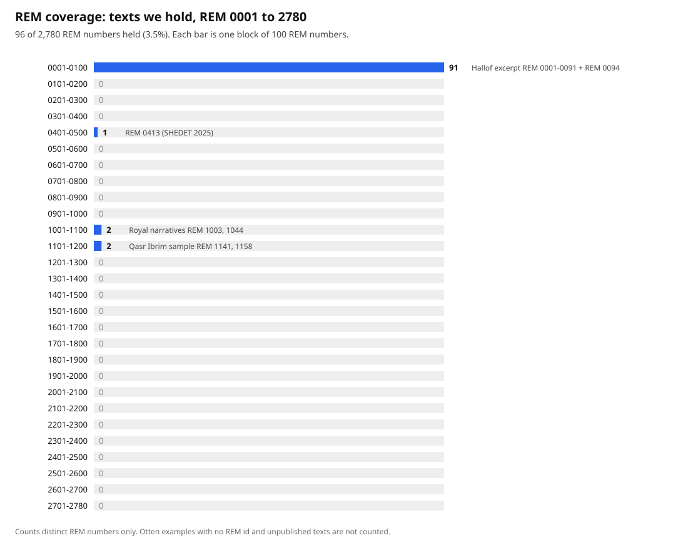

# REM coverage: what we hold vs what is missing

The chart shows which REM numbers we hold, in blocks of 100, from REM 0001 to REM 2780.

## The total

- We hold **96 of 2,780** distinct REM numbers (3.5%).
- 24 of the 28 blocks hold 0 texts.
- The 4 blocks that hold texts are:

| Block | Held | What is in it |
|---|---|---|
| 0001-0100 | 91 | Hallof excerpt REM 0001 to 0091, plus REM 0094 |
| 0401-0500 | 1 | REM 0413, from a 2025 journal article |
| 1001-1100 | 2 | Royal narratives REM 1003 and REM 1044 |
| 1101-1200 | 2 | Qasr Ibrim sample REM 1141 and REM 1158 |

## How it was computed

- Start with every record in `rem-texts.json` that carries a REM number. That gives 93 distinct numbers: REM 0001 to 0091 (except 0072), plus 0094, 1003, and 1044.
- Add REM 0413 from the SHEDET 2025 ingest.
- Add the 15 Griffith REM matches. All 15 sit inside REM 0001 to 0092, so they add 0 new numbers.
- Add REM 1141 and REM 1158 from the Qasr Ibrim sample.
- Total: 93 + 1 + 0 + 2 = 96.
- The numbers and the per-block counts live in `rem-coverage.json` next to this file.
- The chart was built by `build_v02.py` in the run folder `handover-meroitic-v1-2026-11-20/merge-benchmark/corpus-v0.2/`.

## What it omits

- Unpublished texts. About 900 texts are unpublished, including the 88 Qasr Ibrim Vol. III texts, REM 2692 to 2780. None of them is counted here.
- Otten examples with no REM number. The corpus holds 366 Otten example texts. They carry no REM number, so the chart cannot place them.
- REM 0072 and REM 0092. Both appear in the Hallof excerpt as records with 0 tokens. REM 0072 is non-Meroitic with no transcription. REM 0092 is cut off at the end of the free excerpt. Neither holds a transcription, so neither counts as a held text.
- The full Hallof Vol. 7, REM 0093 to 2780, is print only. We hold only the excerpt, REM 0001 to 0092.

## How to move a block

- Add a text with a REM number to the corpus, in the record format in `CONTRIBUTING.md`.
- Re-run the coverage build. The block count rises by one, and the chart updates.
- The biggest gap is REM 0093 to 2780. That is the Hallof Vol. 7 range, and it needs publisher permission or a new digitisation effort.
